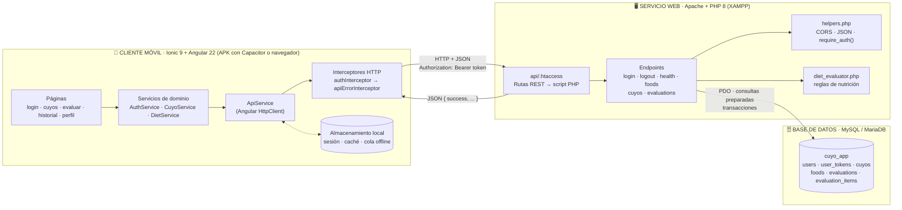
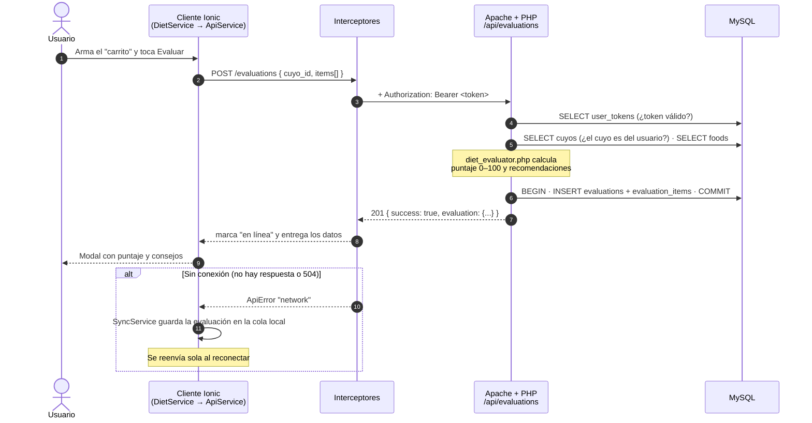

# 🏗️ Arquitectura cliente móvil ↔ servicio web — Cuyo Saludable v1.1.0

> **Unidad II:** convertir la aplicación de la Unidad I en un **cliente móvil** (Ionic + Angular)
> que consume un **servicio web REST** (PHP) conectado a una **base de datos** (MySQL).

| # | Entregable                                        | Dónde está                                                                 |
|---|---------------------------------------------------|----------------------------------------------------------------------------|
| 1 | Diagrama Cliente → API → Base de datos            | [§1](#1-diagrama-cliente--api--base-de-datos)                              |
| 2 | Lista de endpoints requeridos                     | [§2](#2-lista-de-endpoints-requeridos) · `api/.htaccess` · `core/api-endpoints.ts` |
| 3 | Métodos HTTP utilizados                           | [§3](#3-métodos-http-utilizados)                                           |
| 4 | Modelo JSON de intercambio de información         | [§4](#4-modelo-json-de-intercambio) · `src/app/interfaces/`                |
| 5 | Servicio Angular preparado para consumir la API   | [§5](#5-servicio-angular-para-consumir-la-api) · `src/app/core/` y `src/app/services/` |
| 6 | Explicación de la arquitectura propuesta          | [§6](#6-explicación-de-la-arquitectura-propuesta)                          |
| 7 | Evidencia de uso de IA                            | [§7](#7-evidencia-de-uso-de-ia) · [`BITACORA_IA.md`](BITACORA_IA.md) (Sesión 5) |

---

## 1. Diagrama Cliente → API → Base de datos



**Versión en texto** (por si el visor no muestra Mermaid):

```
┌──────────────── CLIENTE MÓVIL (Ionic + Angular) ────────────────┐
│  Páginas  →  Servicios (Auth/Cuyo/Diet)  →  ApiService (HttpClient)│
│                                    │            │                 │
│                     localStorage ◄─┘     Interceptores            │
│              (sesión, caché, cola offline)  (token + errores)     │
└──────────────────────────────────────────────┬───────────────────┘
                     HTTP/JSON  (GET·POST·PUT·DELETE, Bearer token)│
┌──────────────── SERVICIO WEB (Apache + PHP 8) ▼──────────────────┐
│  .htaccess (rutas REST) → endpoint PHP → helpers / diet_evaluator │
└──────────────────────────────────────────────┬───────────────────┘
                              PDO (consultas preparadas, transacciones)
┌──────────────── BASE DE DATOS (MySQL) ────────▼──────────────────┐
│  users · user_tokens · cuyos · foods · evaluations · eval_items   │
└───────────────────────────────────────────────────────────────────┘
```

### Recorrido de una petición: evaluar una dieta



---

## 2. Lista de endpoints requeridos

URL base: `http://<servidor>/proyecto/api`, por ejemplo `http://localhost/proyecto/api` en la PC o `http://192.168.1.50/proyecto/api` desde el celular.
Las rutas REST las define `api/.htaccess` y apuntan a un script PHP. Las URLs antiguas (`*.php?id=`) siguen funcionando.

| # | Método | Ruta REST                     | Auth | Descripción                                         | Respuesta OK | Script PHP                       |
|---|--------|-------------------------------|:----:|-----------------------------------------------------|:------------:|----------------------------------|
| 1 | GET    | `/health`                     |  —   | Estado del servicio y de la BD (probar conexión)    | 200          | `health.php`                     |
| 2 | POST   | `/auth/login`                 |  —   | Inicia sesión y devuelve un token (7 días)          | 200          | `login.php`                      |
| 3 | POST   | `/auth/logout`                |  🔒  | Invalida el token                                   | 200          | `logout.php`                     |
| 4 | GET    | `/foods`                      |  🔒  | Catálogo de alimentos                               | 200          | `foods.php`                      |
| 5 | GET    | `/cuyos`                      |  🔒  | Cuyos del usuario, con su último puntaje            | 200          | `cuyos.php`                      |
| 6 | GET    | `/cuyos/{id}`                 |  🔒  | Un cuyo                                             | 200          | `cuyos.php?id={id}`              |
| 7 | POST   | `/cuyos`                      |  🔒  | Registra un cuyo                                    | **201**      | `cuyos.php`                      |
| 8 | PUT    | `/cuyos/{id}`                 |  🔒  | Actualiza un cuyo                                   | 200          | `cuyos.php?id={id}`              |
| 9 | DELETE | `/cuyos/{id}`                 |  🔒  | Elimina el cuyo y sus evaluaciones (CASCADE)        | 200          | `cuyos.php?id={id}`              |
| 10| GET    | `/cuyos/{id}/evaluations`     |  🔒  | Historial de un cuyo (sub-recurso)                  | 200          | `evaluations.php?cuyo_id={id}`   |
| 11| GET    | `/evaluations`                |  🔒  | Historial del usuario (últimas 50)                  | 200          | `evaluations.php`                |
| 12| GET    | `/evaluations/{id}`           |  🔒  | Detalle: alimentos + recomendaciones                | 200          | `evaluations.php?id={id}`        |
| 13| POST   | `/evaluations`                |  🔒  | Evalúa una dieta y la guarda                        | **201**      | `evaluations.php`                |
| 14| DELETE | `/evaluations/{id}`           |  🔒  | Elimina una evaluación                              | 200          | `evaluations.php?id={id}`        |

🔒 = requiere el header `Authorization: Bearer <token>`. Si falta o expiró, la respuesta es `401`.

Cualquier ruta que no exista responde `404 { "success": false, "message": "Ruta no encontrada" }` en JSON (`not_found.php`).
Los archivos internos (`config.php`, `helpers.php` y `diet_evaluator.php`) responden `403` si se piden por URL.

En el cliente, las mismas rutas están en **un solo archivo**, [`ionic-app/src/app/core/api-endpoints.ts`](ionic-app/src/app/core/api-endpoints.ts):

```ts
export const ENDPOINTS = {
  health: '/health',
  login: '/auth/login',
  logout: '/auth/logout',
  foods: '/foods',
  cuyos: '/cuyos',
  cuyo: (id: number) => `/cuyos/${id}`,
  cuyoEvaluations: (cuyoId: number) => `/cuyos/${cuyoId}/evaluations`,
  evaluations: '/evaluations',
  evaluation: (id: number) => `/evaluations/${id}`,
} as const;
```

---

## 3. Métodos HTTP utilizados

| Método      | Uso en la API                         | ¿Lleva cuerpo JSON? | ¿Idempotente?* | Códigos de éxito |
|-------------|---------------------------------------|:-------------------:|:--------------:|------------------|
| **GET**     | Leer: listas, detalle, catálogo, estado | No                | Sí             | 200              |
| **POST**    | Crear: cuyo, evaluación. Acciones: login y logout | Sí     | No             | 201 al crear, 200 en acciones |
| **PUT**     | Reemplazar todos los datos de un cuyo | Sí                  | Sí             | 200              |
| **DELETE**  | Eliminar un cuyo o una evaluación     | No                  | Sí             | 200              |
| **OPTIONS** | *Preflight* CORS: lo envía el navegador o la WebView antes de PUT/DELETE o de peticiones con `Authorization` desde otro origen (APK) | No | Sí | 200 |

\* *Idempotente:* repetir la misma petición deja el servidor igual. Por eso la cola offline solo guarda **POST /evaluations**, y cada evaluación pendiente se envía **una sola vez** (se borra de la cola en cuanto el servidor responde).

**Códigos de error, iguales en todos los endpoints:**

| Código | Significado                                  | Qué hace la app (`apiErrorInterceptor`)            |
|--------|----------------------------------------------|----------------------------------------------------|
| 400    | Datos inválidos (validación)                 | `ApiError('validation')`: muestra el mensaje del servidor |
| 401    | Token ausente, inválido o expirado; credenciales incorrectas | Cierra la sesión y lleva al login   |
| 403    | Usuario inactivo                             | Muestra el mensaje                                 |
| 404    | El recurso no existe **o es de otro usuario** | `ApiError('not_found')`                           |
| 405    | Método no permitido (ej. `PATCH`)            | Muestra el mensaje                                 |
| 500    | Error interno; el detalle va al log, no al cliente | Muestra "Error del servidor"                 |
| 0 / 502 / 503 / 504 / *timeout* 8 s | Sin conexión con el servidor | `ApiError('network')`: usa la caché o la cola offline |

---

## 4. Modelo JSON de intercambio

### 4.1 Formato general: el mismo "sobre" en todas las respuestas

```jsonc
// Éxito: success = true + los datos del endpoint
{ "success": true, "cuyo": { ... } }

// Error: success = false + mensaje listo para mostrar al usuario
{ "success": false, "message": "El peso debe estar entre 50 y 3000 gramos" }
```

- Peticiones y respuestas: `Content-Type: application/json; charset=UTF-8` (los emojis y acentos viajan tal cual).
- Nombres de campos en `snake_case`, iguales a las columnas de la BD y a las interfaces TypeScript.
- Fechas en formato `"YYYY-MM-DD HH:MM:SS"`. Ids y cantidades son números.

En TypeScript ([`interfaces/api.interface.ts`](ionic-app/src/app/interfaces/api.interface.ts)):

```ts
export type ApiResponse<T extends object = object> = { success: true; message?: string } & T;
export interface ApiErrorResponse { success: false; message: string; }

export type CuyoResponse = ApiResponse<{ cuyo: Cuyo }>;            // GET/POST/PUT de un cuyo
export type CuyoListResponse = ApiResponse<{ cuyos: Cuyo[] }>;     // GET /cuyos
export type EvaluationResponse = ApiResponse<{ evaluation: EvaluationDetail }>;
// ... uno por cada respuesta (ver archivo)
```

### 4.2 Entidades

| Entidad (JSON)      | Interfaz TS          | Campos                                                                                          |
|---------------------|----------------------|-------------------------------------------------------------------------------------------------|
| Usuario             | `User`               | `id` number · `name` string · `email` string                                                    |
| Cuyo                | `Cuyo`               | `id` · `name` · `sex` `"macho" \| "hembra"` · `age_months` 0–120 · `weight_g` 50–3000 · `last_score` number\|null · `last_level` nivel\|null |
| Alimento            | `Food`               | `id` · `name` · `emoji` · `category` `heno\|agua\|verdura\|pellet\|fruta\|prohibido` · `portion_size` · `vitamin_c_mg` |
| Evaluación (resumen)| `EvaluationSummary`  | `id` · `cuyo_id` · `cuyo_name` · `score` 0–100 · `level` `excelente\|buena\|regular\|peligro` · `created_at` |
| Evaluación (detalle)| `EvaluationDetail`   | resumen + `feedback[]` `{ type: ok\|warning\|danger, text }` + `items[]` `{ name, emoji, quantity }` |

### 4.3 Ejemplos reales (capturados con `curl` contra la API en XAMPP)

**Login**: `POST /auth/login`
```json
// Petición (LoginRequest)
{ "email": "demo@correo.com", "password": "123456" }

// Respuesta 200 (LoginResponse)
{
  "success": true,
  "message": "Login exitoso",
  "token": "5205e1fac1da42977f122eed87f06f092c0e401f81a74dfdb59bf81467b07e95",
  "expires_at": "2026-10-18 03:46:44",
  "user": { "id": 1, "name": "Usuario Demo", "email": "demo@correo.com" }
}
```

**Crear o editar un cuyo**: `POST /cuyos` · `PUT /cuyos/1`
```json
// Petición (CuyoForm)
{ "name": "Pelusa", "sex": "hembra", "age_months": 14, "weight_g": 950 }

// Respuesta 201 / 200 (CuyoResponse)
{
  "success": true,
  "cuyo": { "id": 1, "name": "Pelusa", "sex": "hembra", "age_months": 14, "weight_g": 950,
            "last_score": null, "last_level": null }
}
```

**Catálogo**: `GET /foods`
```json
{
  "success": true,
  "foods": [
    { "id": 1, "name": "Heno", "emoji": "🌾", "category": "heno", "portion_size": "1 puñado grande", "vitamin_c_mg": 0 },
    { "id": 3, "name": "Pimiento", "emoji": "🫑", "category": "verdura", "portion_size": "1 tira (20 g)", "vitamin_c_mg": 25 }
  ]
}
```

**Evaluar una dieta**: `POST /evaluations`
```json
// Petición (EvaluationRequest): el "carrito"
{
  "cuyo_id": 1,
  "items": [
    { "food_id": 1, "quantity": 3 },
    { "food_id": 2, "quantity": 1 },
    { "food_id": 5, "quantity": 2 }
  ]
}

// Respuesta 201 (EvaluationResponse). El puntaje lo calcula el SERVIDOR.
{
  "success": true,
  "evaluation": {
    "id": 17, "cuyo_id": 1, "cuyo_name": "Pelusa",
    "score": 80, "level": "buena", "created_at": "2026-10-10 19:46:44",
    "feedback": [
      { "type": "ok",      "text": "Tiene heno, la base de su dieta y clave para desgastar sus dientes." },
      { "type": "ok",      "text": "Tiene agua fresca disponible." },
      { "type": "warning", "text": "Pocas verduras: ofrécele de 3 a 6 porciones al día." },
      { "type": "warning", "text": "Una cucharada de pellets al día complementa su nutrición." },
      { "type": "ok",      "text": "Buen aporte de vitamina C (26 mg)." }
    ],
    "items": [
      { "name": "Heno", "emoji": "🌾", "quantity": 3 },
      { "name": "Agua fresca", "emoji": "💧", "quantity": 1 },
      { "name": "Brócoli", "emoji": "🥦", "quantity": 2 }
    ]
  }
}
```

**Historial**: `GET /evaluations` · `GET /cuyos/3/evaluations`
```json
{
  "success": true,
  "evaluations": [
    { "id": 15, "cuyo_id": 3, "cuyo_name": "Cui", "score": 10,  "level": "peligro",   "created_at": "2026-10-01 23:01:04" },
    { "id": 14, "cuyo_id": 3, "cuyo_name": "Cui", "score": 100, "level": "excelente", "created_at": "2026-10-01 23:00:43" }
  ]
}
```

**Eliminar / cerrar sesión**: `DELETE /cuyos/1` · `DELETE /evaluations/17` · `POST /auth/logout`
```json
{ "success": true, "message": "Evaluación eliminada" }
```

**Estado del servicio**: `GET /health`
```json
{ "success": true, "service": "Cuyo Saludable API", "version": "1.1.0", "database": "ok",
  "server_time": "2026-10-11T03:38:36+02:00" }
```

**Errores**
```json
// 400: validación (se juntan todos los errores en un solo mensaje)
{ "success": false, "message": "El nombre es obligatorio (máx. 50 caracteres). El sexo debe ser macho o hembra. La edad debe estar entre 0 y 120 meses. El peso debe estar entre 50 y 3000 gramos" }
// 401
{ "success": false, "message": "Sesión inválida o expirada" }
// 404
{ "success": false, "message": "El cuyo no existe" }
```

### 4.4 Modelo local (solo en el dispositivo)

Una evaluación hecha sin conexión se guarda en `localStorage` como `PendingEvaluation`: el mismo `EvaluationRequest` más datos locales. Al sincronizar se envía **solo** `{ cuyo_id, items }`.

```json
{ "cuyo_id": 1, "items": [{ "food_id": 1, "quantity": 3 }],
  "local_id": 1760140004000, "cuyo_name": "Pelusa", "created_at": "2026-10-10T19:46:44.000Z" }
```

---

## 5. Servicio Angular para consumir la API

### 5.1 Piezas

| Archivo (`ionic-app/src/app/…`)  | Responsabilidad                                                                 |
|----------------------------------|---------------------------------------------------------------------------------|
| `app.module.ts`                  | Registra `provideHttpClient(withInterceptors([loadingInterceptor, authInterceptor, apiErrorInterceptor]))` |
| `core/api-endpoints.ts`          | Todas las rutas REST (`ENDPOINTS`)                                              |
| `core/api.service.ts`            | **Cliente HTTP genérico**: URL base configurable, `get/post/put/delete`, caché offline y `checkHealth()` |
| `core/auth.interceptor.ts`       | Agrega `Authorization: Bearer <token>` a cada petición                          |
| `core/api-error.interceptor.ts`  | *Timeout* de 8 s, estado de conexión, conversión a `ApiError` y cierre de sesión en 401 |
| `core/api-error.ts`              | Clase `ApiError` (`network`, `unauthorized`, `validation`, `not_found`, `server`) |
| `core/loading.interceptor.ts`    | *(v1.2)* Cuenta las peticiones en curso para la barra de carga global |
| `core/loading.service.ts`        | *(v1.2)* Estado de carga (`isBusy`) y aviso bloqueante `run('Eliminando...')` |
| `services/auth.service.ts`       | `login()` · `logout()`                                                          |
| `services/cuyo.service.ts`       | CRUD de cuyos: `list()` · `get()` · `create()` · `update()` · `remove()`        |
| `services/diet.service.ts`       | `getFoods()` · `getHistory()` · `getEvaluation()` · `evaluate()` (con cola offline) · `deleteEvaluation()` |
| `core/sync.service.ts`           | Cola offline: reenvía las evaluaciones pendientes al reconectar                |
| `interfaces/*.ts`                | Modelo JSON tipado (§4)                                                         |

```
 Página ──► CuyoService.update(id, form)
              └─► ApiService.put<CuyoResponse>(ENDPOINTS.cuyo(id), form)
                     └─► HttpClient ──► authInterceptor ──► apiErrorInterceptor ──► red
                                         (+ Bearer token)    (timeout, errores)
```

### 5.2 Cliente HTTP: `ApiService` (extracto)

```ts
@Injectable({ providedIn: 'root' })
export class ApiService {
  private http = inject(HttpClient);
  readonly baseUrl = signal(this.storage.get<string>(API_URL_KEY) ?? environment.apiUrl);

  get<T>(path: string): Promise<T>                  { return this.request<T>('GET', path); }
  post<T>(path: string, body?: unknown): Promise<T> { return this.request<T>('POST', path, body); }
  put<T>(path: string, body: unknown): Promise<T>   { return this.request<T>('PUT', path, body); }
  delete<T>(path: string): Promise<T>               { return this.request<T>('DELETE', path); }

  async getCached<T>(path: string): Promise<T> { /* sin red -> devuelve la última copia */ }
  checkHealth(url = this.baseUrl()): Promise<HealthResponse> { /* GET /health */ }

  private request<T>(method: string, path: string, body?: unknown): Promise<T> {
    return firstValueFrom(this.http.request<T>(method, this.baseUrl() + path, { body }));
  }
}
```

### 5.3 Interceptores

```ts
// auth.interceptor.ts
export const authInterceptor: HttpInterceptorFn = (req, next) => {
  const token = inject(SessionService).token;
  return next(token ? req.clone({ setHeaders: { Authorization: `Bearer ${token}` } }) : req);
};

// api-error.interceptor.ts (resumen)
return next(req).pipe(
  timeout(8000),
  tap((event) => event instanceof HttpResponse && connectivity.markOnline()),
  catchError((error) => throwError(() => toApiError(error))), // 0/504 -> 'network', 401 -> logout, 400 -> 'validation'...
);
```

### 5.4 Servicio de dominio: `CuyoService` (completo)

```ts
@Injectable({ providedIn: 'root' })
export class CuyoService {
  private api = inject(ApiService);

  async list(): Promise<Cuyo[]> {
    return (await this.api.getCached<CuyoListResponse>(ENDPOINTS.cuyos)).cuyos;
  }
  async get(id: number): Promise<Cuyo> {
    return (await this.api.getCached<CuyoResponse>(ENDPOINTS.cuyo(id))).cuyo;
  }
  async create(form: CuyoForm): Promise<Cuyo> {
    return (await this.api.post<CuyoResponse>(ENDPOINTS.cuyos, form)).cuyo;
  }
  async update(id: number, form: CuyoForm): Promise<Cuyo> {
    return (await this.api.put<CuyoResponse>(ENDPOINTS.cuyo(id), form)).cuyo;
  }
  async remove(id: number): Promise<void> {
    await this.api.delete(ENDPOINTS.cuyo(id));
  }
}
```

### 5.5 Uso desde una página (versión simplificada de `cuyo-form.page.ts`)

```ts
export class CuyoFormPage {
  private cuyoService = inject(CuyoService);
  private notify = inject(NotifyService);

  async save() {
    try {
      const cuyo = await this.cuyoService.create(this.form.getRawValue());
      await this.notify.success(`¡${cuyo.name} fue registrado!`);
    } catch (error) {
      await this.notify.error(error); // muestra el mensaje del ApiError (ej. validación del servidor)
    }
  }
}
```

### 5.6 Configurar a qué servidor se conecta

| Escenario                    | Archivo / lugar                       | URL de la API                         |
|------------------------------|---------------------------------------|---------------------------------------|
| Desarrollo (`npm start`)     | `environments/environment.ts`         | `http://localhost/proyecto/api`       |
| Web servida por XAMPP        | `environments/environment.prod.ts`    | `/proyecto/api` (mismo servidor)      |
| APK en el celular            | `environments/environment.mobile.ts`  | `http://192.168.1.50/proyecto/api`    |
| Cambiarla sin recompilar     | App → **Perfil → Servidor**: **Probar conexión** (`GET /health`) y **Guardar** | La que escriba el usuario |

### 5.7 Pruebas del servicio

`core/api.service.spec.ts` usa `HttpTestingController` para comprobar, sin servidor real, que:
se arma la URL REST y se envía el token; el POST lleva el cuerpo JSON; un 400 se convierte en `ApiError('validation')`;
la falta de respuesta da `'network'` y marca la app sin conexión; un 401 cierra la sesión; y `getCached` usa la copia guardada cuando no hay red.

---

## 6. Explicación de la arquitectura propuesta

### 6.1 Estilo: cliente–servidor en 3 capas, con API REST sin estado

| Capa                   | Tecnología                         | Responsabilidad                                                              | NO hace                                  |
|------------------------|------------------------------------|------------------------------------------------------------------------------|------------------------------------------|
| **Presentación** (cliente móvil) | Ionic 9 + Angular 22, Capacitor | Pantallas, formularios con validación, navegación, caché y cola offline     | No calcula puntajes ni accede a la BD    |
| **Lógica / servicio web** | Apache + PHP 8 (REST/JSON)      | Autenticación por token, validación, autorización por usuario, reglas de nutrición, transacciones | No genera HTML: solo JSON |
| **Datos**              | MySQL / MariaDB                    | Persistencia, integridad (FK, `ON DELETE CASCADE`, `UNIQUE`)                 | No es accesible desde el cliente          |

**Por qué así:**
1. **El cliente nunca toca la BD.** La única puerta de entrada es la API, así que las credenciales de MySQL viven solo en el servidor (`config.php`, bloqueado por URL).
2. **Una sola fuente de verdad.** El puntaje se calcula en `diet_evaluator.php`. Si se cambian las reglas, todos los clientes (web y APK) las usan sin reinstalar nada, y nadie puede alterar su puntaje desde el teléfono.
3. **API sin estado (*stateless*).** Cada petición trae su token `Bearer`, así que el servidor no guarda sesiones en memoria y puede atender a varios clientes a la vez.
4. **Recursos y verbos REST.** Las URLs nombran recursos (`/cuyos/5`) y el método HTTP dice la acción. Cualquier cliente (Ionic, Postman, otra app) entiende la API sin leer el código.
5. **Contrato JSON único** (`{ success, ... }`) y tipado en TypeScript. Si el backend cambia un campo, el compilador de Angular avisa.

### 6.2 Organización del cliente (separación de responsabilidades)

```
pages/        → qué se ve            (no saben de HTTP)
services/     → qué datos se piden   (AuthService, CuyoService, DietService)
core/         → cómo se piden        (ApiService, interceptores, sesión, caché, cola offline)
interfaces/   → forma de los datos   (modelo JSON tipado)
```
Gracias a esta separación, cambiar Axios por `HttpClient` en esta unidad **no tocó ninguna página**: solo `core/`.

### 6.3 Seguridad

| Medida                                             | Dónde                                     |
|----------------------------------------------------|-------------------------------------------|
| Contraseñas con `password_hash` (bcrypt)           | `users.password`, `login.php`             |
| Token aleatorio de 64 caracteres con vencimiento (7 días), invalidable con logout | `user_tokens`, `require_auth()` |
| Cada consulta filtra por `user_id`: un recurso ajeno responde 404 (no revela que existe) | `find_cuyo()`, `EVALUATION_SELECT` |
| Consultas preparadas con PDO (evita inyección SQL) | Todos los endpoints                       |
| Validación en cliente **y** en servidor            | `cuyo-form.page.ts` / `validate_cuyo()`   |
| Errores internos ocultos al cliente (500 genérico + log) | `set_exception_handler`             |
| Archivos internos no accesibles por URL (403)      | `api/.htaccess`                           |

### 6.4 Operación sin conexión (*offline-first* básico)

- **Lecturas** (`GET`): `ApiService.getCached` guarda cada respuesta. Sin red, devuelve la última copia y la app muestra un aviso.
- **Escrituras de evaluaciones** (`POST /evaluations`): `SyncService` las guarda en una cola local y las reenvía al reconectar (evento `online`, cada 30 s o con el botón "Sincronizar ahora").
- **CRUD de cuyos:** requiere conexión, porque un conflicto de edición sería difícil de resolver sin servidor. La app lo informa con un mensaje claro.
- **Archivos de la app (web):** el Service Worker de Angular los guarda para que la app abra sin red. En el APK ya vienen dentro del instalador.

### 6.5 Despliegue

```
          Misma red WiFi
┌──────────────┐   HTTP    ┌─────────────────────────────────┐
│ 📱 Celular   │ ────────► │ 💻 PC con XAMPP (192.168.1.50)  │
│  APK Ionic   │           │  Apache :80 → /proyecto/api     │
└──────────────┘           │  MySQL  :3306 → cuyo_app        │
┌──────────────┐   HTTP    │  /proyecto/app → versión web    │
│ 🌐 Navegador │ ────────► │                                 │
└──────────────┘           └─────────────────────────────────┘
```

### 6.6 Cambios de la Unidad I → Unidad II

| Aspecto                | Unidad I (v1.0)                              | Unidad II (v1.1)                                               |
|------------------------|----------------------------------------------|----------------------------------------------------------------|
| Cliente HTTP           | Axios (librería externa)                     | **Angular `HttpClient`** + interceptores funcionales           |
| Token y errores        | Dentro de `ApiService`, mezclados con la petición | **Interceptores** separados (`auth`, `api-error`)          |
| URLs                   | `cuyos.php?id=5`                             | **REST:** `/cuyos/5`, `/cuyos/5/evaluations`, `/auth/login` (las antiguas siguen funcionando) |
| Rutas en el cliente    | Textos repartidos en cada servicio           | Un solo archivo: `ENDPOINTS`                                   |
| Modelo de respuestas   | `{ cuyos: Cuyo[] }` escrito a mano en cada llamada | Tipos `ApiResponse<T>`, `CuyoResponse`, etc.             |
| Estado del servicio    | —                                            | `GET /health` + botón **Probar conexión** en Perfil            |
| Rutas inexistentes     | Página HTML 404 de Apache                    | `404` en JSON                                                  |
| Archivos internos PHP  | Accesibles por URL                           | Bloqueados (`403`)                                             |
| Pruebas unitarias      | 11                                           | 17 (+6 del cliente HTTP)                                       |

### 6.7 Cómo probar la API

```bash
B=http://localhost/proyecto/api
curl $B/health
TOKEN=$(curl -s -X POST $B/auth/login -H "Content-Type: application/json" \
        -d '{"email":"demo@correo.com","password":"123456"}' | sed 's/.*"token":"\([^"]*\)".*/\1/')
curl -H "Authorization: Bearer $TOKEN" $B/cuyos
curl -X POST -H "Authorization: Bearer $TOKEN" -H "Content-Type: application/json" \
     -d '{"name":"Copito","sex":"macho","age_months":4,"weight_g":520}' $B/cuyos
```

---

## 7. Evidencia de uso de IA

La IA (Claude Code) se usó para **analizar** la arquitectura de la Unidad I, **proponer mejoras** e **implementarlas y verificarlas**.
Los prompts de cada paso, lo que la IA encontró, las decisiones que se tomaron y las pruebas realizadas están en
[`BITACORA_IA.md` → Sesión 5](BITACORA_IA.md#sesión-5--10102026--cliente-móvil-conectado-a-un-servicio-web-unidad-ii).
