# 📸 Conectar la app Ionic con una API REST — evidencias (v1.2.0)

| Requisito                        | Dónde está en el código                                                                              | Evidencia |
|----------------------------------|------------------------------------------------------------------------------------------------------|-----------|
| **Petición GET**                 | `CuyoService.list()` / `get()`, `DietService.getFoods()` / `getHistory()` / `getEvaluation()`, `ApiService.checkHealth()` | [GET](#1-petición-get) |
| **Petición POST**                | `AuthService.login()`, `CuyoService.create()`, `DietService.evaluate()`                              | [POST](#2-petición-post) |
| **PUT/PATCH**                    | `CuyoService.update()` → `PUT /cuyos/{id}`                                                           | [PUT](#3-petición-put) |
| **DELETE**                       | `CuyoService.remove()`, `DietService.deleteEvaluation()`                                             | [DELETE](#4-petición-delete) |
| **Servicios Angular**            | `core/api.service.ts` (HttpClient) + `services/auth`, `cuyo`, `diet` + 3 interceptores                | [Servicios](#5-servicios-angular) |
| **Manejo de respuestas y errores** | `core/api-error.interceptor.ts` → `ApiError`, `NotifyService` (toasts), validación de formularios  | [Errores](#6-manejo-de-respuestas-y-errores) |
| **Loading durante las solicitudes** | `core/loading.interceptor.ts` + `LoadingService` (barra global y "Eliminando..."), spinners por página | [Loading](#7-loading-durante-las-solicitudes) |
| **Capturas o video**             | 27 capturas en [`docs/evidencias/capturas/`](docs/evidencias/capturas/) y video [`recorrido-api-rest.mp4`](docs/evidencias/video/recorrido-api-rest.mp4) (1 min 19 s) | Este documento |
| **Código subido a Git**          | Commit y tag `v1.2.0` en el repositorio                                                               | `git log` / `git tag` |

---

## Cómo se generaron

Las capturas y el video se generaron **automáticamente** con [`docs/evidencias/generar-evidencias.mjs`](docs/evidencias/generar-evidencias.mjs). El script usa Playwright y Microsoft Edge contra la app real servida por XAMPP, y la conecta a la API PHP y a MySQL.

- **Panel oscuro inferior:** lo dibuja el script, **no es parte de la app**. Muestra cada petición que la app hace a la API: método, ruta, código HTTP, tiempo y el inicio del JSON de respuesta.
- **Retraso artificial de 1.2 s por petición:** también lo agrega el script. En `localhost` la API responde en milisegundos y el loading no alcanzaría a verse.
- **Barra amarilla delgada arriba:** es el **indicador de carga global de la app** (ver §7).

Para repetirlo, con XAMPP encendido:
```bash
npm i playwright-core ffmpeg-static
node docs/evidencias/generar-evidencias.mjs docs/evidencias
```

🎬 **Video completo:** [`docs/evidencias/video/recorrido-api-rest.mp4`](docs/evidencias/video/recorrido-api-rest.mp4): login con error → GET → POST → PUT → POST de una evaluación → DELETE → errores 404 y sin conexión → DELETE → GET /health → logout.

---

## 1. Petición GET

| Lista de cuyos: `GET /cuyos` → 200 | Detalle: `GET /cuyos/{id}` + `GET /cuyos/{id}/evaluations` | Detalle de evaluación: `GET /evaluations/{id}` |
|:--:|:--:|:--:|
|  | 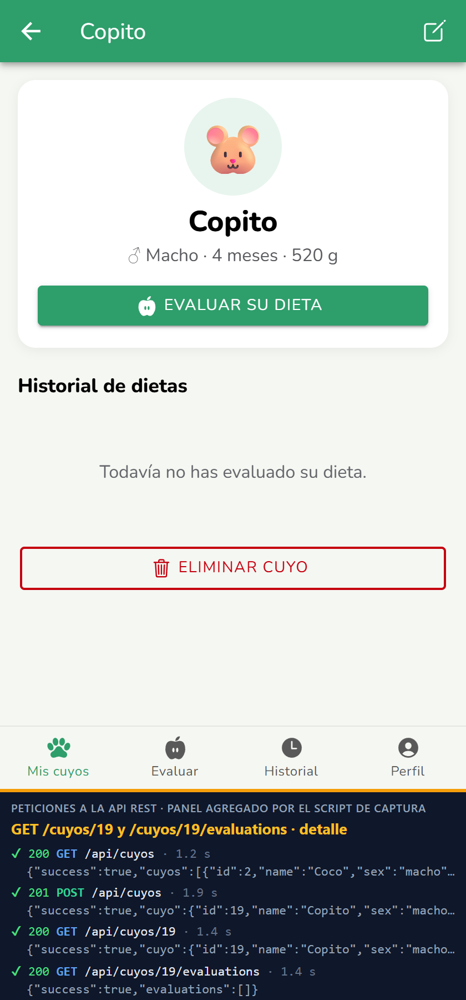 | 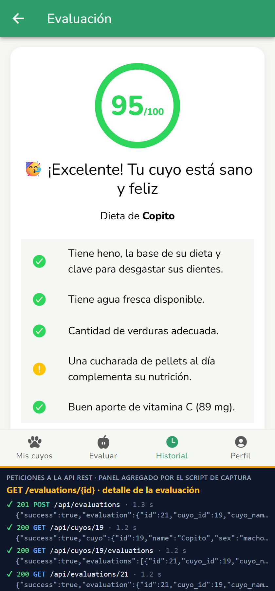 |

```ts
// services/cuyo.service.ts
async list(): Promise<Cuyo[]> {
  const data = await this.api.getCached<CuyoListResponse>(ENDPOINTS.cuyos); // GET /cuyos
  return data.cuyos;
}
```

## 2. Petición POST

| Formulario: el cuerpo JSON | Respuesta `201`: "¡Copito fue registrado!" | `POST /evaluations` → 201 con puntaje |
|:--:|:--:|:--:|
| 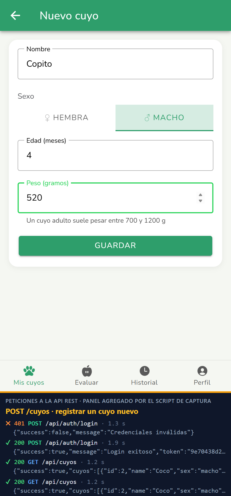 | 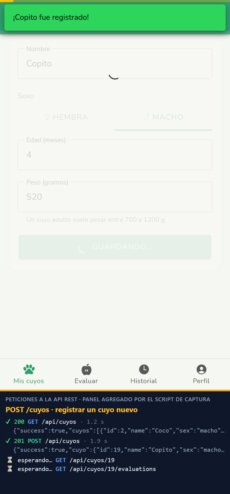 | 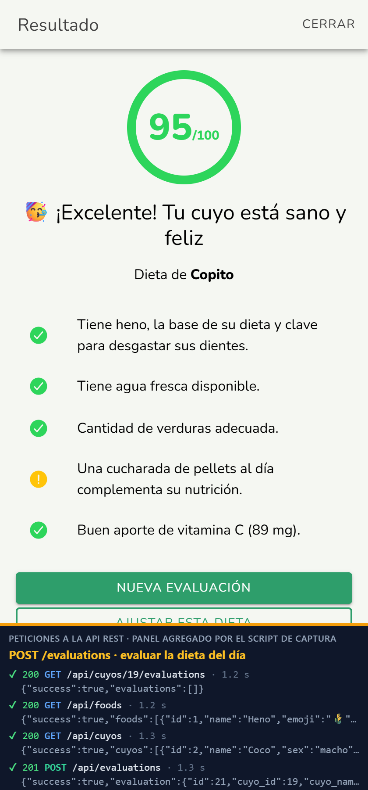 |

```ts
async create(form: CuyoForm): Promise<Cuyo> {
  const data = await this.api.post<CuyoResponse>(ENDPOINTS.cuyos, form); // POST /cuyos  { name, sex, age_months, weight_g }
  return data.cuyo;
}
```

## 3. Petición PUT

| Formulario precargado con `GET` y modificado | Respuesta `200`: el detalle ya muestra 5 meses y 610 g |
|:--:|:--:|
| 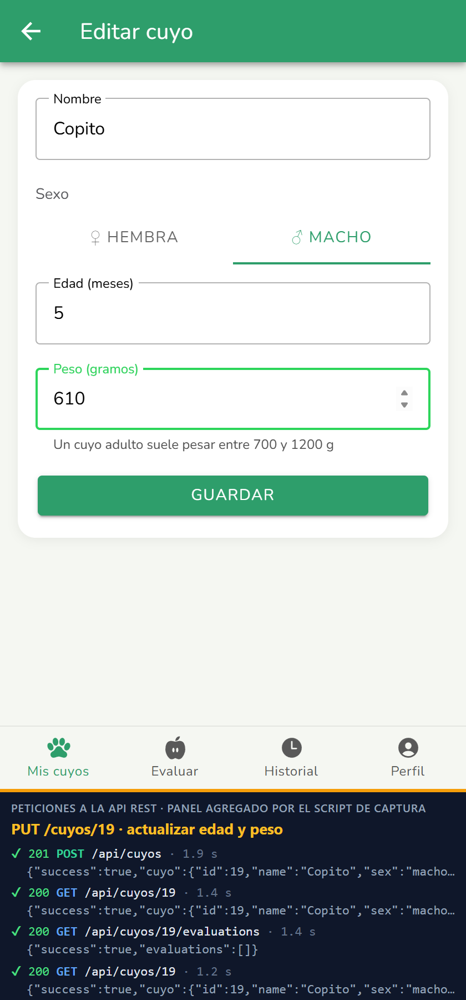 | 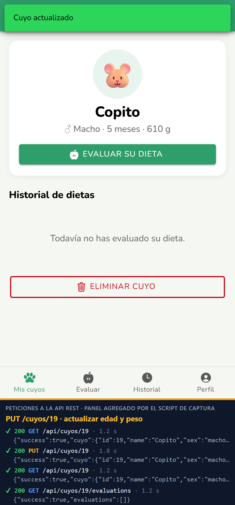 |

```ts
async update(id: number, form: CuyoForm): Promise<Cuyo> {
  const data = await this.api.put<CuyoResponse>(ENDPOINTS.cuyo(id), form); // PUT /cuyos/{id}
  return data.cuyo;
}
```
Se usa **PUT** (y no PATCH) porque el formulario siempre envía el cuyo completo, es decir, reemplaza todos sus datos.

## 4. Petición DELETE

| Confirmación | Durante el `DELETE` | Respuesta `200` |
|:--:|:--:|:--:|
| 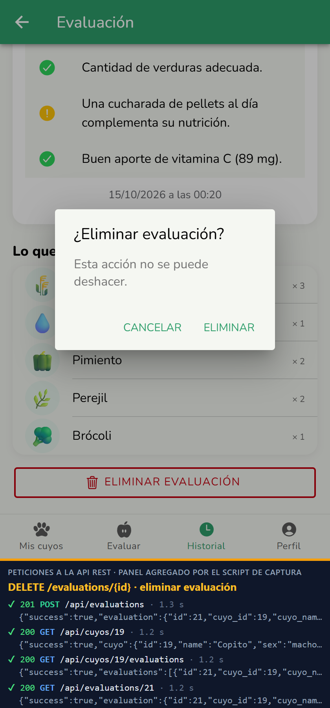 | 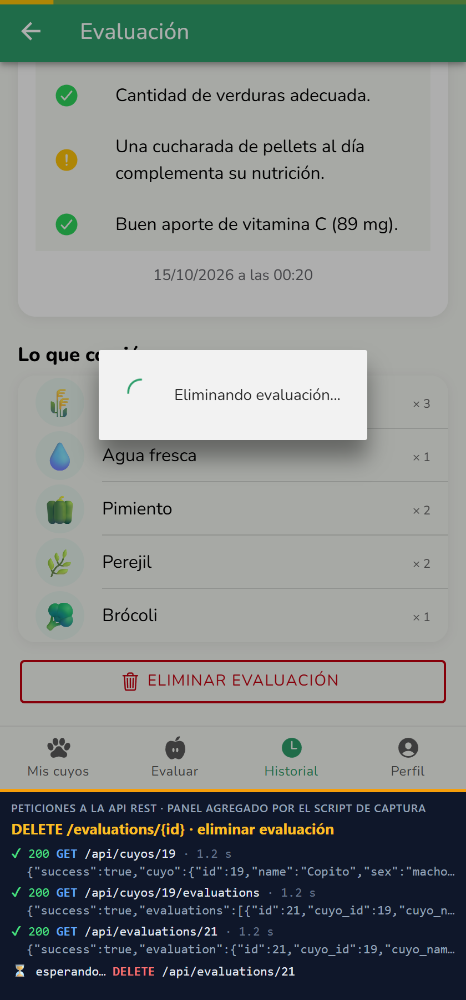 | 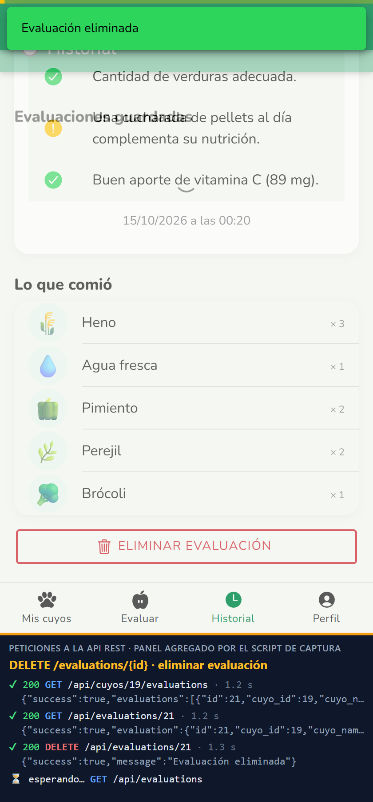 |

| Eliminar cuyo: `DELETE /cuyos/{id}` | Respuesta `200` |
|:--:|:--:|
| 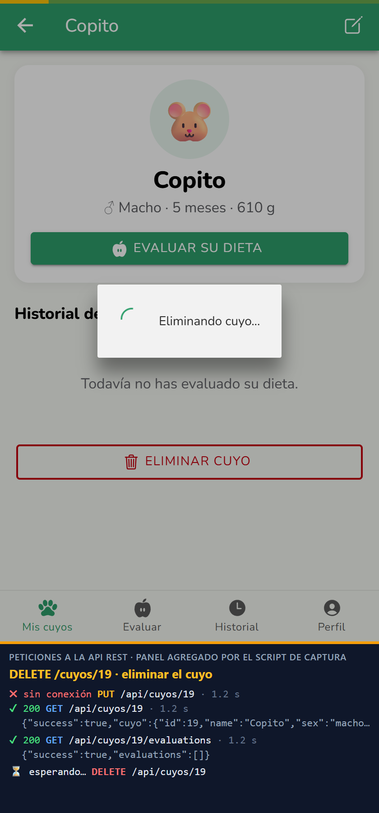 | 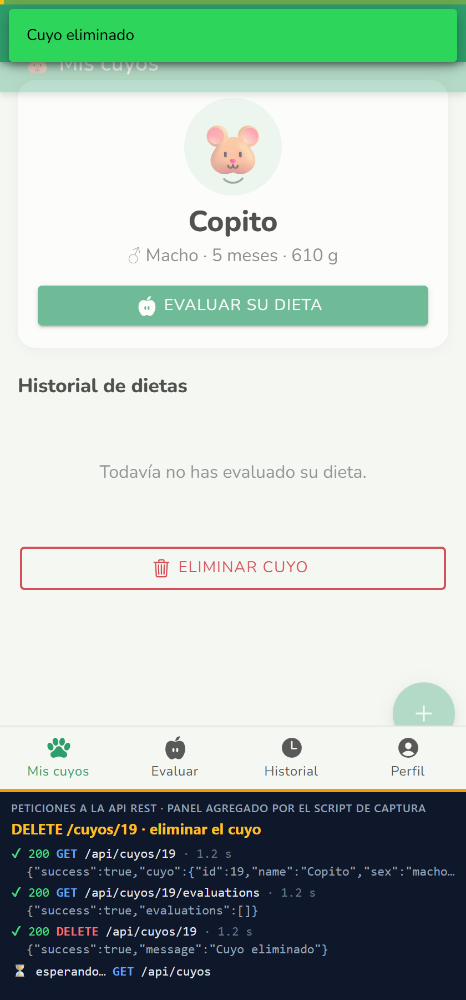 |

```ts
async remove(id: number): Promise<void> {
  await this.api.delete(ENDPOINTS.cuyo(id)); // DELETE /cuyos/{id}
}
```

## 5. Servicios Angular

```
Página ─► Servicio de dominio ─► ApiService (HttpClient) ─► interceptores ─► API REST (PHP) ─► MySQL
           AuthService             get / post / put /         1. loadingInterceptor   (barra de carga)
           CuyoService             delete / getCached         2. authInterceptor      (Bearer token)
           DietService                                        3. apiErrorInterceptor  (timeout, ApiError)
```

| Archivo (`ionic-app/src/app/…`)  | Qué hace                                                                 |
|----------------------------------|--------------------------------------------------------------------------|
| `core/api.service.ts`            | Cliente HTTP: URL del servidor, GET/POST/PUT/DELETE y caché offline       |
| `core/api-endpoints.ts`          | Todas las rutas de la API en un solo lugar                               |
| `core/loading.interceptor.ts`    | Cuenta las peticiones en curso → barra de carga global                   |
| `core/auth.interceptor.ts`       | Agrega `Authorization: Bearer <token>`                                   |
| `core/api-error.interceptor.ts`  | Timeout de 8 s y conversión de errores HTTP a `ApiError`                 |
| `services/*.service.ts`          | Operaciones del negocio que usan las páginas                             |
| `interfaces/api.interface.ts`    | Tipos de cada respuesta JSON (`CuyoResponse`, `EvaluationResponse`…)     |

Detalle completo en [`ARQUITECTURA.md` §5](ARQUITECTURA.md#5-servicio-angular-para-consumir-la-api).

## 6. Manejo de respuestas y errores

Cada respuesta se tipa (`ApiResponse<T>`) y cada error se convierte en un `ApiError` con un mensaje claro para el usuario:

| Situación | Código | Lo que hace la app | Evidencia |
|---|---|---|---|
| Éxito | 200 / 201 | Muestra los datos y un toast verde | capturas 08, 13, 20, 24 |
| Contraseña incorrecta | 401 | Toast "Credenciales inválidas" | 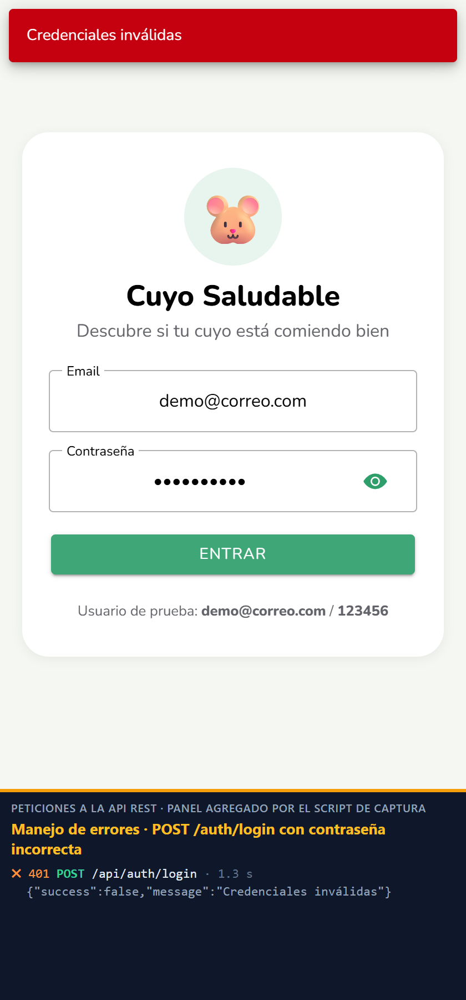 |
| Recurso inexistente | 404 | Toast "El cuyo no existe" y regresa a la lista | 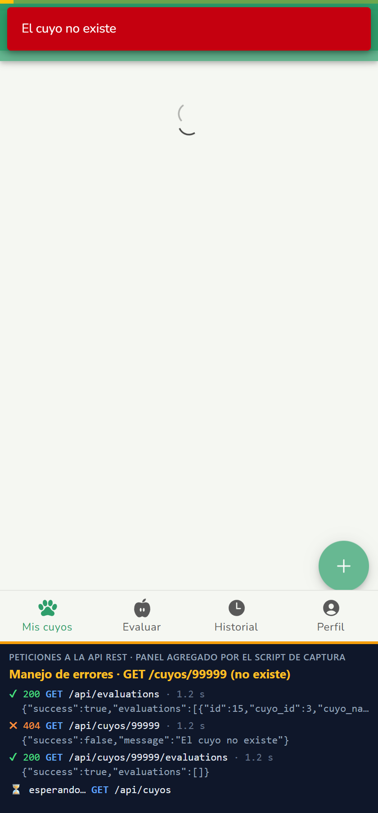 |
| Sin conexión con el servidor | 0 / timeout | Toast "Sin conexión…", banner amarillo y los datos guardados siguen visibles | 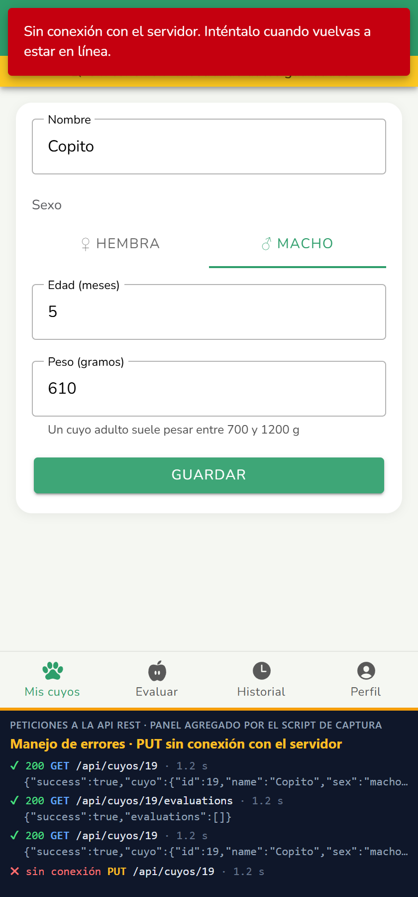 |
| Datos inválidos | 400 (y validación previa en el cliente) | El formulario no se envía y marca los campos | 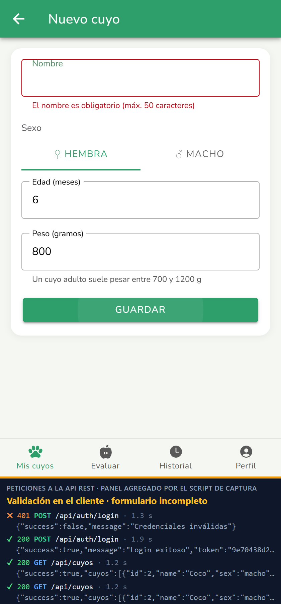 |
| Sesión expirada | 401 con token | Cierra la sesión y lleva al login | prueba unitaria `api.service.spec.ts` |

```ts
// core/api-error.interceptor.ts (resumen)
return next(req).pipe(
  timeout(8000),
  catchError((error) => throwError(() => toApiError(error))), // 0/504 → 'network', 400 → 'validation', 404 → 'not_found'...
);

// En la página
try {
  await this.cuyoService.update(id, data);
  await this.notify.success('Cuyo actualizado');
} catch (error) {
  await this.notify.error(error); // muestra el mensaje del ApiError
}
```

## 7. Loading durante las solicitudes

Hay **dos niveles**, y así ninguna solicitud queda sin indicador:

1. **Barra de carga global:** `loadingInterceptor` cuenta las peticiones en curso, y mientras haya alguna, `app.component.html` muestra una `ion-progress-bar` en la parte superior. Funciona en **todas** las peticiones, sin código extra en cada página.
2. **Indicador en el lugar de la acción:** spinners al cargar listas, botones "Guardando...", "Evaluando..." y "Probando...", y un aviso bloqueante "Eliminando..." (`LoadingService.run`) en los DELETE.

| Login (botón + barra) | GET de la lista | GET para editar |
|:--:|:--:|:--:|
| 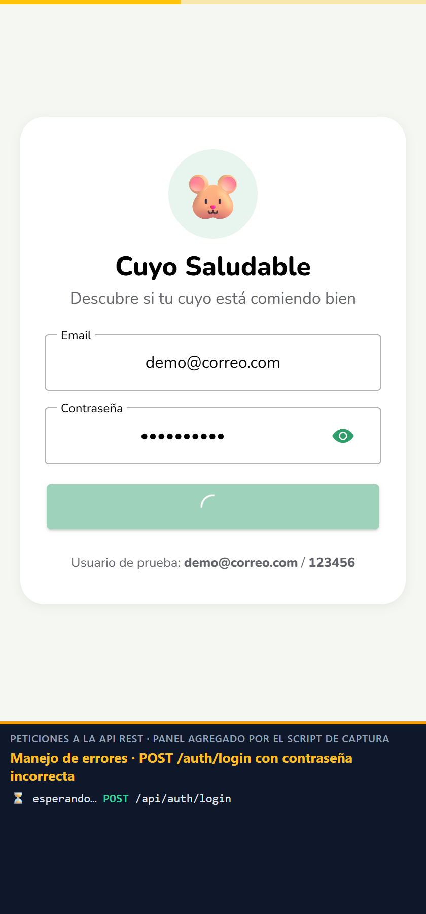 | 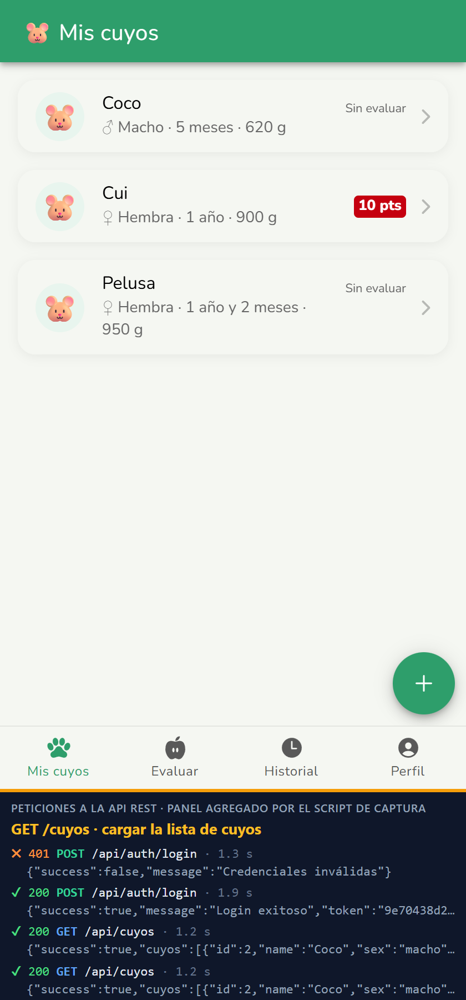 | 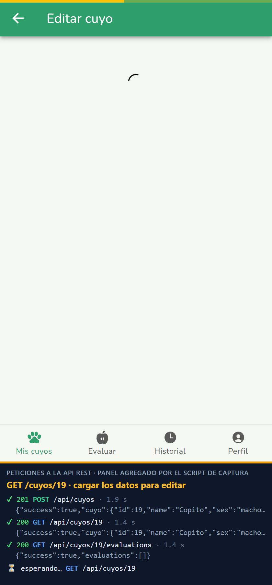 |

| POST "Guardando..." | PUT "Guardando..." | POST "Evaluando..." | GET /health "Probando..." |
|:--:|:--:|:--:|:--:|
| 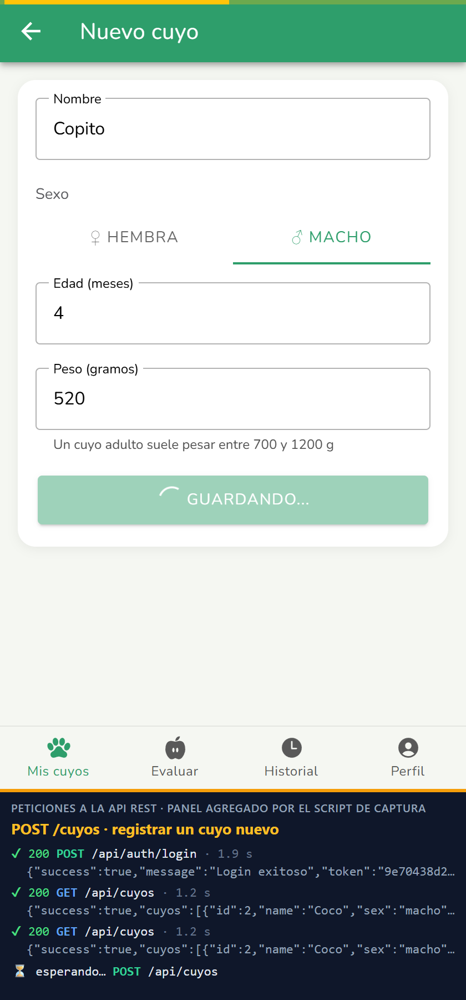 | 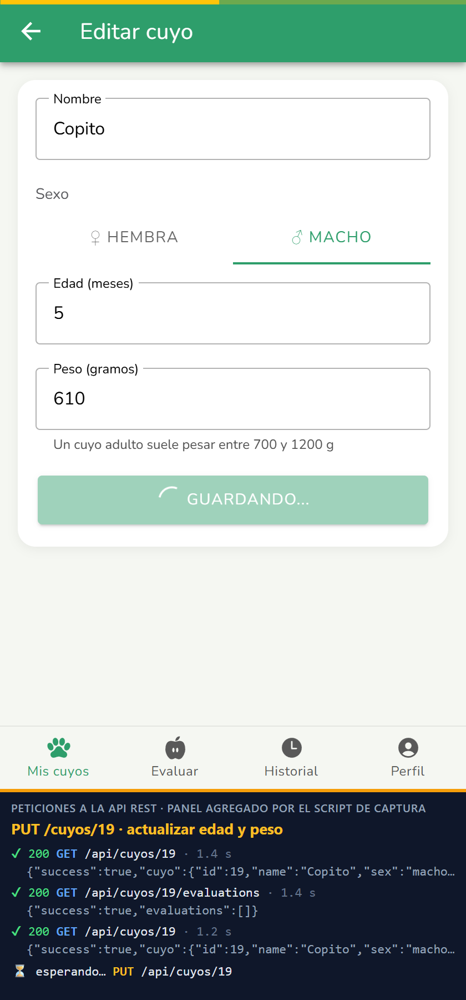 | 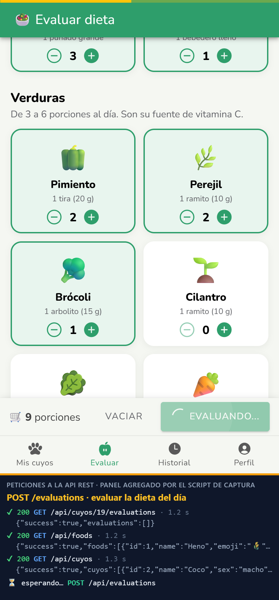 | 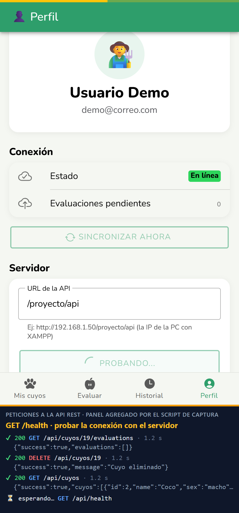 |

```ts
// core/loading.interceptor.ts
export const loadingInterceptor: HttpInterceptorFn = (req, next) => {
  const loading = inject(LoadingService);
  loading.start();
  return next(req).pipe(finalize(() => loading.stop())); // se apaga aunque la petición falle
};

// En un DELETE
await this.loading.run('Eliminando cuyo...', () => this.cuyoService.remove(this.id));
```

---

## Verificación

| Prueba | Resultado |
|---|---|
| Pruebas unitarias (Vitest) | 5 archivos, **18 pruebas aprobadas**, incluida la de la barra de carga (se enciende durante la petición y se apaga aunque falle) |
| `ng lint` | Sin errores |
| Recorrido automatizado (27 pasos) | Completo, **0 errores de JavaScript** en la página |
