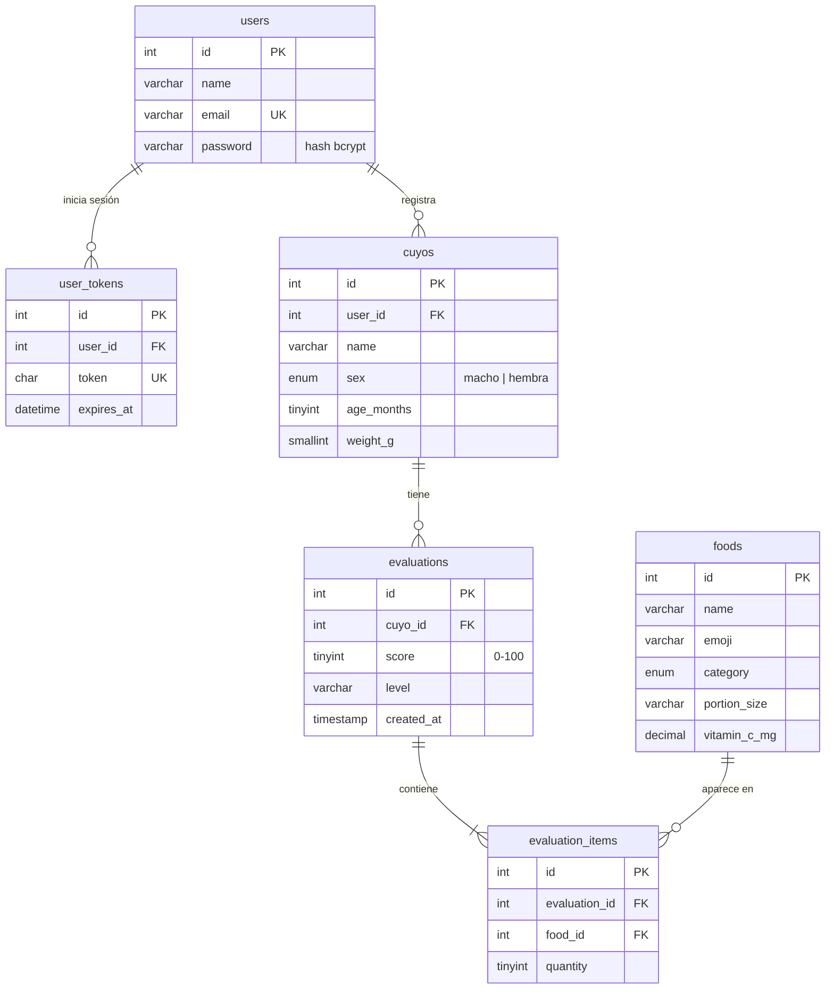

# 🐹 Cuyo Saludable — v1.0.0

Aplicación móvil/web hecha con **Ionic + Angular** para registrar a tus cuyos (cobayas) y evaluar si su dieta diaria es saludable.
El usuario arma el menú del día como un "carrito" de alimentos, y el backend calcula un **puntaje de 0 a 100** con recomendaciones.
Cada evaluación se guarda en una base de datos MySQL. La app sigue funcionando **sin conexión**.

| Capa       | Tecnología                                                            |
|------------|-----------------------------------------------------------------------|
| Frontend   | Ionic 9 · Angular 22 (componentes standalone + signals) · Axios       |
| Backend    | PHP 8 (API REST en JSON) · PDO                                        |
| Base datos | MySQL / MariaDB (XAMPP)                                               |
| Offline    | Caché local + cola de sincronización + Service Worker                 |
| Móvil      | Capacitor (Android)                                                   |
| Pruebas    | Vitest (unitarias) · Playwright (de punta a punta, manual)            |

---

## ✅ Requisitos de la entrega y dónde se cumplen

| Requisito                     | Implementación                                                                                                     |
|-------------------------------|---------------------------------------------------------------------------------------------------------------------|
| Proyecto Ionic funcional      | `ionic-app/`, ya compilado en `app/` y servido por XAMPP                                                            |
| Navegación                    | Login + 4 pestañas (Mis cuyos, Evaluar, Historial, Perfil) + páginas de detalle y formulario. Ver [mapa](#-navegación) |
| Modelo de datos               | 6 tablas relacionadas ([diagrama](#-modelo-de-datos)) + interfaces TypeScript en `src/app/models/`                  |
| CRUD                          | **Cuyos**: crear, leer, editar y eliminar. **Evaluaciones**: crear, leer y eliminar                                  |
| Persistencia                  | MySQL en el servidor; `localStorage` en el dispositivo (sesión, caché y cola offline)                                |
| Manejo de errores             | Validaciones en front y back, errores tipados (`ApiError`), sesión expirada, manejador global. Ver [detalle](#-manejo-de-errores) |
| Operación offline básica      | Lectura desde caché, evaluaciones en cola con sincronización automática, app disponible sin red. Ver [detalle](#-operación-offline) |
| Repositorio Git               | Historial de commits por etapa y tag `v1.0.0`                                                                       |
| APK o ejecución demostrable   | Ejecución en XAMPP (`http://localhost/proyecto`) y configuración de Capacitor lista para el APK                      |
| README.md                     | Este archivo                                                                                                        |
| Bitácora de desarrollo con IA | [`BITACORA_IA.md`](BITACORA_IA.md)                                                                                  |

---

## 🚀 Cómo ejecutar (solo XAMPP, sin Node)

La app ya viene **compilada** en la carpeta `app/`. Apache sirve tanto el frontend como la API.

1. Copia la carpeta del proyecto a `C:\xampp\htdocs\proyecto`.
   El nombre **`proyecto`** es obligatorio, porque la app busca sus archivos en `/proyecto/app/`. No hace falta copiar `ionic-app/node_modules`.
2. En el panel de XAMPP, enciende **Apache** y **MySQL**.
3. Importa la base de datos: en phpMyAdmin (`http://localhost/phpmyadmin`) ve a **Importar** y elige `sql/cuyo_app.sql`.
   ⚠️ El script borra y vuelve a crear la base `cuyo_app`.
4. Abre **http://localhost/proyecto**

**Usuario de prueba:** `demo@correo.com` / `123456`. Ya tiene dos cuyos registrados: Pelusa y Coco.

| URL                                  | Qué es                     |
|--------------------------------------|----------------------------|
| `http://localhost/proyecto`          | Redirige a la app          |
| `http://localhost/proyecto/app/`     | Frontend compilado (Ionic) |
| `http://localhost/proyecto/api/...`  | API PHP                    |

---

## 🗂️ Estructura del proyecto

```
proyecto/
├── index.php                      # Redirige /proyecto -> /proyecto/app/
├── app/                           # Frontend COMPILADO (lo sirve Apache). Se genera con "npm run build"
├── api/                           # Backend PHP (API REST)
│   ├── config.php                 # Conexión PDO a MySQL
│   ├── helpers.php                # CORS, respuestas JSON, errores, validación de token
│   ├── login.php / logout.php     # Sesión
│   ├── cuyos.php                  # CRUD de cuyos
│   ├── foods.php                  # Catálogo de alimentos
│   ├── evaluations.php            # Crear / listar / detalle / eliminar evaluaciones
│   └── diet_evaluator.php         # Reglas de nutrición (cálculo del puntaje)
├── sql/cuyo_app.sql               # Esquema + datos iniciales
├── BITACORA_IA.md                 # Bitácora de desarrollo asistido por IA
└── ionic-app/                     # Código fuente del frontend
    ├── ngsw-config.json           # Qué archivos guarda el Service Worker
    ├── capacitor.config.ts        # Configuración del APK
    └── src/app/
        ├── app-routing.module.ts  # Mapa completo de navegación
        ├── core/                  # Infraestructura: API, sesión, errores, offline
        │   ├── api.service.ts         # Axios + ApiError + caché
        │   ├── sync.service.ts        # Cola offline y sincronización
        │   ├── connectivity.service.ts
        │   ├── storage.service.ts     # Persistencia local (localStorage)
        │   ├── session.service.ts
        │   ├── notify.service.ts      # Toasts
        │   ├── global-error-handler.ts
        │   └── auth.guard.ts
        ├── models/                # user, cuyo, diet (tipos de datos)
        ├── services/              # auth, cuyo, diet (lógica de negocio del frontend)
        ├── shared/                # Componentes reutilizables (resultado, aviso offline, pipe de edad)
        └── pages/                 # login, tabs, cuyos, cuyo-form, cuyo-detail,
                                   # evaluate, history, evaluation-detail, profile
```

---

## 🧭 Navegación

```
/login
/tabs                              (requiere sesión: authGuard)
  ├─ /cuyos                        Mis cuyos (lista)          ← READ
  │    ├─ /nuevo                   Formulario                 ← CREATE
  │    ├─ /:id                     Detalle + historial        ← READ / DELETE
  │    └─ /:id/editar              Formulario                 ← UPDATE
  ├─ /evaluar                      Formulario "carrito" (?cuyo=ID lo preselecciona)
  ├─ /historial                    Evaluaciones guardadas + pendientes offline
  │    └─ /:id                     Detalle de una evaluación
  └─ /perfil                       Usuario, conexión, sincronizar, servidor, cerrar sesión
```

Las páginas se cargan bajo demanda (*lazy loading*). Además, `guestGuard` evita volver al login si ya hay una sesión abierta.

---

## 🧩 Modelo de datos



Las llaves foráneas usan `ON DELETE CASCADE`: al eliminar un cuyo, también se eliminan sus evaluaciones y los alimentos de cada una.

---

## 🔌 API REST

Todas las rutas, excepto `login.php`, requieren el header `Authorization: Bearer <token>`.
Las respuestas siempre son JSON: `{ "success": true, ... }` o `{ "success": false, "message": "..." }`.

| Método | Ruta                               | Descripción                                   |
|--------|------------------------------------|-----------------------------------------------|
| POST   | `/api/login.php`                   | Inicia sesión, devuelve token (7 días)        |
| POST   | `/api/logout.php`                  | Invalida el token                             |
| GET    | `/api/cuyos.php`                   | Lista de cuyos (con su último puntaje)        |
| GET    | `/api/cuyos.php?id=1`              | Un cuyo                                       |
| POST   | `/api/cuyos.php`                   | Crea `{ name, sex, age_months, weight_g }`    |
| PUT    | `/api/cuyos.php?id=1`              | Actualiza                                     |
| DELETE | `/api/cuyos.php?id=1`              | Elimina (y sus evaluaciones)                  |
| GET    | `/api/foods.php`                   | Catálogo de alimentos                         |
| GET    | `/api/evaluations.php[?cuyo_id=1]` | Historial (opcionalmente de un cuyo)          |
| GET    | `/api/evaluations.php?id=7`        | Detalle: alimentos + recomendaciones          |
| POST   | `/api/evaluations.php`             | Evalúa y guarda `{ cuyo_id, items: [{ food_id, quantity }] }` |
| DELETE | `/api/evaluations.php?id=7`        | Elimina una evaluación                        |

Códigos de respuesta: `200/201` éxito · `400` datos inválidos · `401` sesión inválida · `403` usuario inactivo · `404` no existe (o es de otro usuario) · `405` método no permitido · `500` error del servidor.

---

## 🛡️ Manejo de errores

**Backend**
- Validación de cada campo, con mensajes claros. Por ejemplo: *"El peso debe estar entre 50 y 3000 gramos"*.
- Cada usuario solo puede ver o modificar **sus propios** cuyos; si intenta acceder a uno ajeno, recibe `404`.
- `set_exception_handler` atrapa cualquier error no previsto y responde `500` en JSON, sin exponer detalles internos.
- Las evaluaciones se guardan en una **transacción**: se guarda todo o nada.

**Frontend**
- `ApiService` convierte cualquier fallo en un `ApiError` de un tipo concreto: `network`, `unauthorized`, `validation`, `not_found` o `server`.
- Sesión expirada (`401`): se cierra la sesión local y la app vuelve al login automáticamente.
- Formularios reactivos con validaciones (las mismas reglas que el backend) y mensajes bajo cada campo.
- Confirmación antes de eliminar.
- `GlobalErrorHandler`: si algún error no se maneja, se registra y se muestra un aviso al usuario en lugar de dejar la app congelada.

---

## 📴 Operación offline

| Situación sin conexión          | Comportamiento                                                                                  |
|---------------------------------|-------------------------------------------------------------------------------------------------|
| Abrir la app o recargarla       | El **Service Worker** sirve la app desde la caché del navegador                                 |
| Ver cuyos, alimentos, historial | Se muestra la **última copia guardada** (`ApiService.getCached`) y una franja amarilla de aviso |
| Evaluar una dieta               | Se guarda en una **cola local** (`SyncService`) y aparece como "Pendiente" en Historial          |
| Volver a tener conexión         | La cola se **sincroniza sola** (evento `online`, cada 30 s o con "Sincronizar ahora")            |
| Crear, editar o eliminar cuyos  | Requiere conexión: se muestra un mensaje claro                                                   |

**Cómo demostrarlo:**
1. Abre la app con sesión iniciada y navega un poco, para que se guarden los datos.
2. En Chrome/Edge, abre DevTools (F12) → pestaña **Network** → elige **Offline**. También puedes detener Apache.
3. Navega por la app y evalúa una dieta: quedará como pendiente.
4. Vuelve a poner **Online**. La evaluación se envía sola y aparece un aviso "☁️ Se sincronizaron…".

---

## 📏 Reglas de evaluación (`api/diet_evaluator.php`)

Se parte de **100 puntos** y se resta por cada regla que no se cumple:

| Regla                                   | Penalización |
|-----------------------------------------|--------------|
| Sin heno (debe ser el 80 % de la dieta) | −35          |
| Sin agua                                | −20          |
| Verduras fuera de 3–6 porciones         | −15 / −10    |
| Vitamina C menor a 10 mg                | −15          |
| Pellets: ninguno / más de 2             | −5 / −10     |
| Más de 2 porciones de fruta             | −10          |
| Cada alimento prohibido                 | −25          |

Nivel: **≥ 85** excelente · **≥ 60** buena · **≥ 35** regular · **< 35** peligro.

---

## 🛠️ Desarrollo

Requiere **Node.js 22.22.3+ o 24.15+**, que es lo que exige Angular 22.

```bash
cd ionic-app
npm install
npm start -- --port 8100   # desarrollo con recarga automática (usa la API de XAMPP)
npm test                   # pruebas unitarias (Vitest)
npm run build              # recompila y reemplaza la carpeta app/ (versión XAMPP)
```

Si tu Node es más antiguo, puedes anteponer `npx -p node@24` a cualquier comando de Angular. Por ejemplo:
`npx -p node@24 node node_modules/@angular/cli/bin/ng.js build`.

Cada vez que cambies el código, ejecuta `npm run build` y haz commit también de la carpeta `app/`.

### Pruebas automatizadas
- **Unitarias (Vitest):** `AgePipe`, `StorageService`, `SyncService` (cola offline: encolar, sincronizar, reintentar, descartar) y `AppComponent`.
- **De punta a punta (manual con Playwright):** login, CRUD completo, evaluación, historial, modo offline con recarga, sincronización y logout. Los resultados están en la bitácora.

---

## 📱 Generar el APK (Android)

Requiere **Android Studio** (que incluye el SDK y Java).

```bash
cd ionic-app
npm install @capacitor/android@8.5.1
npx cap add android            # solo la primera vez
npm run build:mobile           # compila con base "/" y copia a android/
npx cap open android           # abre Android Studio -> Build > Build APK(s)
```

- El celular y la PC con XAMPP deben estar en la **misma red WiFi**.
- La URL del servidor se cambia dentro de la app, en **Perfil → Servidor**. Ejemplo: `http://192.168.1.50/proyecto/api`. Para saber la IP de tu PC, ejecuta `ipconfig`.
- Si Windows bloquea la conexión, permite Apache en el Firewall (redes privadas).

---

## 👤 Autor

Angel Arzu Herrera Sierra. Desarrollo asistido por IA (Claude Code); ver [`BITACORA_IA.md`](BITACORA_IA.md).
